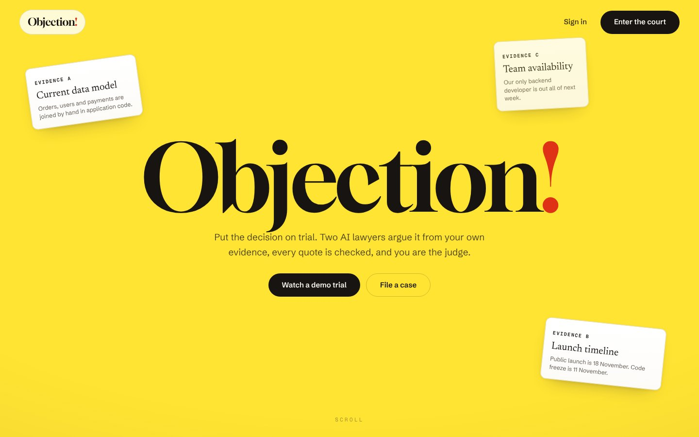
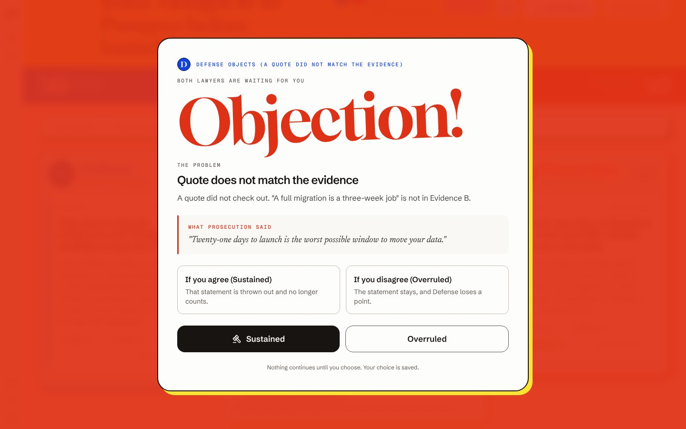
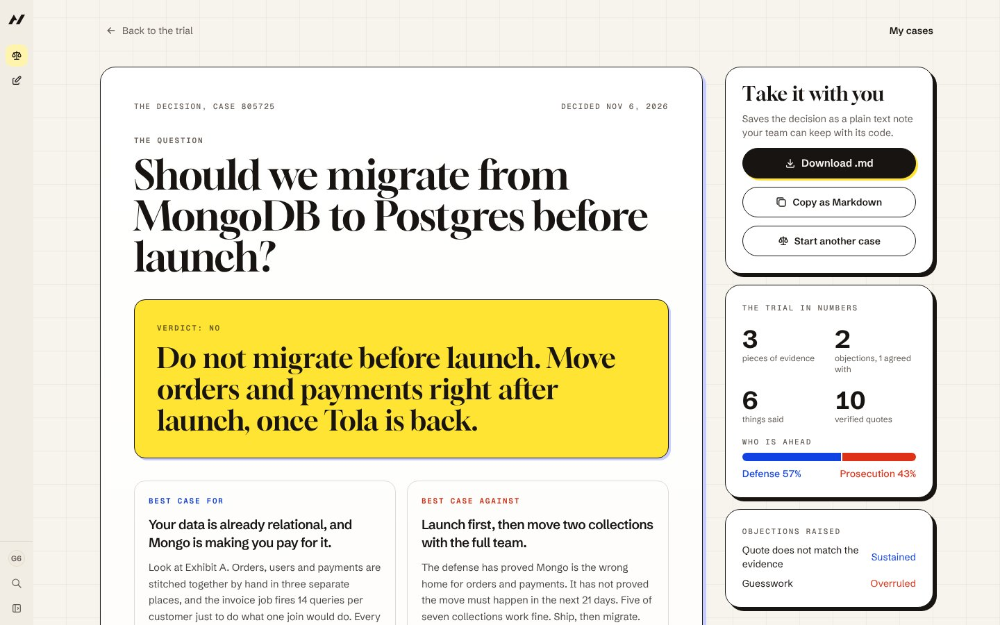
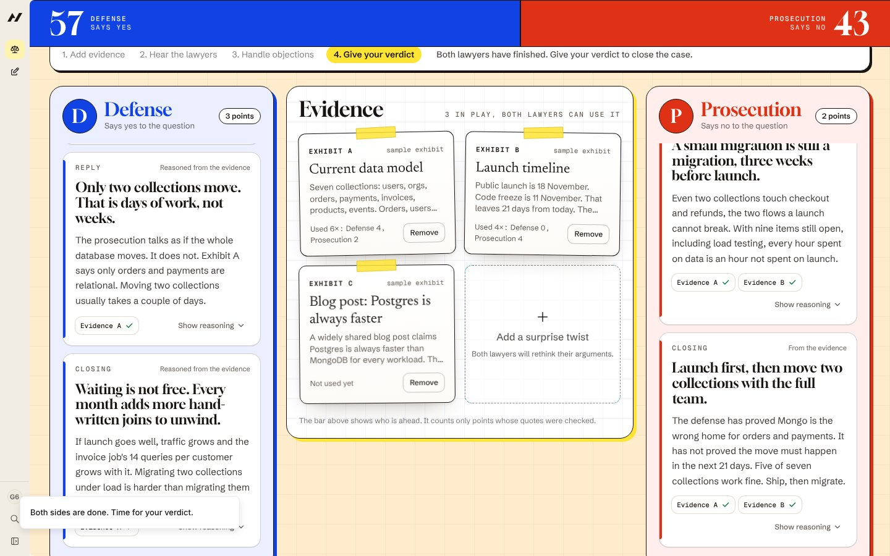

# Objection!

**Put your next decision on trial.** Two AI lawyers argue your yes/no decision from your own evidence, one for and one against. Every quote they use is checked against your evidence. You are the judge.

**Live:** [objection1.vercel.app](https://objection1.vercel.app) (enter as a guest, no sign-up)
Built on [Agent-Native](https://github.com/BuilderIO/agent-native) for the Builder.io Agent-Native Hackathon.



## The problem

Ask an AI about a big decision and it tends to agree with you. That is not advice, it is an echo. Objection! makes the strongest case for and against, using only what you gave it, and shows you where each side's claims are backed by evidence and where they are not.

## How a trial runs

1. **Start a case.** Ask a yes/no question ("Should we migrate to Postgres before launch?") and add your evidence: documents, numbers, notes.
2. **Hear the lawyers.** Defense (says yes) and Prosecution (says no) each speak three times: opening, reply, closing. Every claim points at a piece of your evidence.
3. **Quotes are checked.** If a quote is not in the evidence it cites, the other lawyer objects automatically and the trial stops until you agree (Sustained) or disagree (Overruled).
4. **Step in any time.** Remove evidence, add a surprise twist, or question either lawyer. Both rethink their arguments.
5. **Give your verdict.** It is saved as a short decision write-up: the best case for and against, who was ahead, and when to look at it again. Download it as Markdown and keep it with your code.

| Objection takes over the screen | The decision you keep |
| --- | --- |
|  |  |



## Why it is agent-native

- **One action, every surface.** `file-case`, `add-exhibit`, `advance-trial`, `submit-argument`, `rule-objection`, `deliver-verdict` and the rest are `defineAction`s. The screen, the in-app agent (the Clerk) and the framework's HTTP and MCP endpoints call the same code.
- **The judge stays in charge.** `add-exhibit`, `rule-objection` and `deliver-verdict` use `needsApproval` when an agent calls them. An agent can propose evidence or draft a verdict; a person approves it.
- **One path for every statement.** Arguments written by the AI lawyers and arguments submitted by a person or agent through `submit-argument` all go through the same recording step, so the quote check applies to all of them.
- **Shared state.** The courtroom and the Clerk read the same SQL record, and the transcript shows who did each step (you, the AI, the Clerk, a connected agent).
- **Rules, not vibes.** Quote checking, objections and the "who is ahead" bar are plain code, covered by tests. The model only writes the arguments.

## Try it

Open the live site and choose **Watch a demo trial**. It runs with no API key and walks through a fake quote being caught.

To run it yourself:

```bash
pnpm install
pnpm dev
```

For live AI lawyers on your own cases, put one free key in `.env`:

| Variable | Provider |
| --- | --- |
| `GROQ_API_KEY` | Groq (tried first) |
| `GEMINI_API_KEY` | Google AI Studio |
| `OPENROUTER_API_KEY` | OpenRouter free models |

Optional model overrides: `COUNSEL_GROQ_MODEL`, `COUNSEL_GEMINI_MODEL`, `COUNSEL_OPENROUTER_MODEL`.

## Checks

```bash
pnpm test                    # quote checker and scoring rules
pnpm typecheck
pnpm agent-native:doctor     # framework guard rails
```

## Deploy (Vercel)

1. Import the repo in Vercel. `vercel.json` sets the rest; leave the framework preset alone.
2. Add a Postgres database (Neon from the Vercel Marketplace sets `DATABASE_URL`).
3. For Production, set `BETTER_AUTH_SECRET` (`openssl rand -hex 32`) and one AI key such as `GROQ_API_KEY`.
4. Deploy. `scripts/vercel-build.sh` builds with `NITRO_PRESET=vercel` and, on production only, runs the database migrations.

Keep Fluid Compute on (the default) so AI turns that wait on a model are not cut off at 10 seconds. `netlify.toml` is included for Netlify, but its shorter function limit can cut off slow AI turns.

## Where things live

| Path | What it holds |
| --- | --- |
| `actions/` | The court's actions, shared by the screen, the Clerk and outside agents |
| `server/lib/court/` | Quote checking (`verify.ts`), scoring (`weight.ts`), the AI lawyers (`counsel.ts`), the demo trial (`rehearsal.ts`) |
| `shared/court.ts` | The plain-language vocabulary used everywhere |
| `app/routes/court.*` | My cases, new case, courtroom and decision screens |
| `app/components/landing/` | The scroll-film landing page |
| `app/routes/guest.tsx` | Guest entry: a private throwaway account, no sign-up |
| `DESIGN.md` | The visual design contract |

## What was built when

The project started from the Agent-Native Chat template (sign-in, chat sidebar, framework wiring). Everything specific to Objection! was built during the hackathon: the court engine, quote checking, objections, evidence and verdict flow, decision write-up, landing page, guest entry and the whole courtroom design. See `CHANGELOG.md`.

## Credits

Hero photo by Tim Mus on Unsplash. Fonts: Gloock, Schibsted Grotesk, Newsreader and Geist Mono. MIT licensed, see `LICENSE`.
